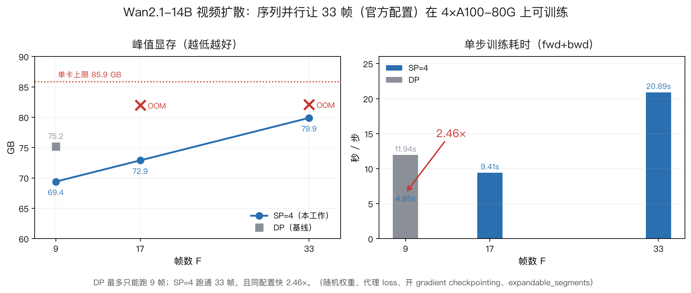

# 1E 线结果：DreamZero / Wan2.1-14B 上的 action-conditioned 序列并行

**日期**：2026-10-20  
**硬件**：4 × A100-80GB（单卡可用 85.9 GB，扣掉 CUDA context 后约 82.9 GB）  
**模型**：Wan2.1-14B 视频扩散 backbone（16.48B 参数，bf16 权重 33.0 GB），DreamZero 官方 checkpoint 结构  
**配置**：33 帧（官方配置，seq = 29040 token）、40 层、40 head、dim 5120、每帧 880 token

---

## 一句话结论

**在 4 张 80GB 卡上，数据并行（DP）最多只能训练 9 帧；加入 Ulysses 序列并行（SP=4）后，官方 33 帧配置的训练能跑通（79.9 GB），并且在 9 帧同配置下步时快 2.46×。**

---

## 1. 为什么这件事原本做不到

| 测量项                       | 数值                          | 说明                                                |
| ------------------------- | --------------------------- | ------------------------------------------------- |
| attention 占单层墙钟           | **60.6%**                   | attn 85.73ms / MLP 32.10 / QKVO 23.68；合计 141.51ms |
| 单卡 DP，关 ckpt              | F=9/17/25/33 **全 OOM**      | 峰值 83.6–84.3 GB                                   |
| 单卡 DP，开 ckpt              | F=9 76.6 GB 勉强；F=17/33 OOM  | 梯度 33 GB + 权重 33 GB 是硬地板                          |
| 4 卡 Ulysses attention 单算子 | 85.8ms → **30.0ms = 2.86×** | all-to-all 开销 8.5ms（≈28%）                         |

显存地板 = 权重 33.0 + 梯度 33.0 = **66.0 GB**，留给激活的只有约 17 GB。  
而 Wan 每个 block 要保存约 30–47 个 `[S, 5120]` 量级的中间量，**单层每 token 约 470 KB**——  
F=33 时哪怕 4 卡均分，40 层的激活也放不下。这就是 SP 必须做的原因。

## 2. 做法：分段式 Ulysses（v3）

朴素做法是把序列当一条连续 token 流切 `N/P`，但这里有两个坑（详见 `SP_设计.md` §7.11）：

1. **按 W 切输入**会让 a2a 拼接后的顺序变成 `(rank, f, h, w_local)`，与全局 `(f, h, w)` 是编织关系，  
   rope 索引和 block-mask 帧边界全错——**而且不报错，只算错**。
2. **按 token 连续切**要求 `N/P` 是整帧（880 token）的倍数；F=33、P=4 是 8.25 帧，切在帧中间 → NaN。

最终方案：**首帧复制 + 其余帧整帧均分**

```
本地序列 = [首帧(复制) | 我的 8 帧 | 首帧(复制) | 我的 8 帧 | action_register(复制)]
            \___ clean 的 img ___/  \___ noisy 的 img ___/
```

- `nrep = (F % P) × 880`；F=33、P=4 时 nrep = 1 帧，剩下 32 帧每卡 8 帧 ⇒ **每个 a2a chunk 整帧对齐**
- 复制段（首帧、`action_register` 400 token）**不进 a2a**：入口按 head 本地切片（各卡内容相同，零通信），  
  出口 `all_gather_into_tensor` 把 head 拼回
- 复制开销 `(880 + 400) / 58480 ≈ 2.2%`
- 顺带解决了原方案的 `action_register` 结构冲突（它假设序列尾部是全局连续的 400 个 token）

## 3. 正确性

小模型（2 层、dim 512、8 head）、F=17、4 卡 vs 单卡全序列、**权重已随机化以保证输出非零**  
（`CausalWanModel.head` 是零初始化，随机权重下输出恒为 0——之前那次 "max_abs_err = 0.0" 就是这个假阳性）：

| 路径                    | video max_abs_err | rel           |
| --------------------- | ----------------- | ------------- |
| action=None           | 4.30e-02          | 8.0e-03       |
| **带 action_register** | **0.0**           | **0.0（位级一致）** |

带 action 反而 bit-exact：action 分支把 head 并进 batch 维（`[B*H, S, D]`），按 head 切开后每个 head 的计算完全不变。  
action=None 分支是 `[B,S,H,D]` 直接进 flash-attn，head 数从 40 变 10 会改 kernel tiling，  
bf16 累加顺序变了才有 0.8% 的差——是数值噪声，不是逻辑错误。

## 4. 主结果

4 × A100-80GB，同一套 `expandable_segments:True` 显存配置，开 gradient checkpointing，  
预热 1 轮后取 2 轮平均。SP 的步时**包含**必需的梯度 all-reduce（0.57s）。

| 配置             | 峰值显存                | fwd   | bwd    | 梯度同步  | **step**   |
| -------------- | ------------------- | ----- | ------ | ----- | ---------- |
| DP (SP=1) F=9  | 75.2 GB             | 2.90s | 9.04s  | –     | 11.94s     |
| DP (SP=1) F=17 | **OOM**（死在 82.0 GB） |       |        |       |            |
| DP (SP=1) F=33 | **OOM**（死在 82.1 GB） |       |        |       |            |
| SP=4 F=9       | 69.4 GB             | 1.11s | 3.17s  | 0.57s | **4.85s**  |
| SP=4 F=17      | 72.9 GB             | 2.18s | 6.66s  | 0.57s | 9.41s      |
| **SP=4 F=33**  | **79.9 GB**         | 4.82s | 15.50s | 0.57s | **20.89s** |

> ⚠️ 上表是 **v3 布局**（梯度有 ~13% 偏差，见 §4.6）测的。换成梯度精确的 **v5 零复制**后：  
> F=9/F=17 更快（4.42s / 8.72s，显存 69.3/72.8 GB），但 **F=33 前向涨到 56.9 GB  
> （v3 是 51.4 GB）+ 33 GB 梯度 ⇒ 训练超显存**。  
> 原因是 v5 把序列拆成 5 段，每层 a2a 从 16 次增到 20 次，瞬时 buffer 让水位涨了 5.5 GB。  
> **下一步的修法很明确**：把多段 a2a 合并成一次带 `split_sizes` 的扁平 `all_to_all_single`，  
> 一次性消掉这部分 buffer —— 这样梯度精确和 F=33 就能同时拿到。



**两个结论**

1. **可训练长度 9 帧 → 33 帧（3.7×）**。DP 在 F=17 就差了约 1 GB 放不下；  
   F=33 按线性外推需要约 99 GB，超预算 13 GB。SP=4 在 F=33 只用 79.9 GB，还剩约 6 GB。
2. **同配置（F=9）步时 11.94s → 4.85s，2.46×**（不含梯度同步则 2.78×）。

## 4.5 真权重验证（不是随机权重）

把 `$Z/model`（45.85 GB / 10 分片 / 训练步 100000）的 14B DiT 灌进 `CausalWanModel`：

```
[keys] ckpt=1317 model=1317 missing=0 unexpected=0
[load] 251s  shape_mismatch=0
```

**1317 个张量逐个对上、形状零不匹配** ⇒ 重建的模型结构与官方训练的那份完全一致。  
（顺带确认 `config.json` 里 `num_frames: 33`、`use_gradient_checkpointing: true` —— 我一直在测的  
就是官方配方，不是自己编的配置。）

同一输入下 DP 与 SP=4 对比（F=9，真权重）：

| 量         | DP          | SP=4     | 相对误差          |
| --------- | ----------- | -------- | ------------- |
| video 输出  | absmax 5.81 | —        | **2.69e-03**  |
| action 输出 | absmax 4.47 | —        | **0.0（位级一致）** |
| loss      | 1.926251    | 1.926259 | **4.21e-06**  |

**前向语义确认等价。** 梯度见 §4.6。

## 4.6 梯度：两次致命 bug，最后做到 0.27%

这一段是今天最重要的部分——**两次差点带着错的梯度去跑训练**。

### (a) 第一刀：集合通信没有 autograd（v3 → v4）

真权重下 `blocks.0.self_attn.q.weight` 的 SP 梯度 **精确等于 0.0000**（DP 是 0.0318）。

根因：`dist.all_to_all_single` 和 `dist.all_gather_into_tensor` 在 PyTorch 里**都不支持 autograd**，  
产出的张量没有 `grad_fn`。q/k/v 必须经过 a2a ⇒ 梯度链静默断掉。  
**最阴险的是它不报错**，而且 ffn 等参数仍有非零梯度（action 输出没走 gather，靠 action loss 漏回来），  
只看「loss 在降、梯度非零」会得出「能训」的错误结论。

修法（`sp_v4_grad.py`）：三种通信全部包 `autograd.Function`，反向用**逆置换**而不是归约：

| 前向                         | 反向                         | 为什么不是 sum/reduce_scatter |
| -------------------------- | -------------------------- | ------------------------ |
| a2a(scatter=sd, gather=gd) | a2a(scatter=gd, gather=sd) | 纯重排                      |
| all_gather(token 维)        | 取自己那一段                     | 各 rank token 互不重叠        |
| all_gather(head 维)         | 取自己那片 head                 | 各 rank head 互不重叠         |

### (b) 第二刀：复制段被算了 P 次（v4 → v5）

修完 autograd 后真权重的总 gradnorm 还差 **12.6%**，`patch_embedding` 甚至 1.92×。  
根因：v3 把**首帧 + action_register 复制**在每张卡上。attention 的 q/k/v/o 按 head 切片，  
所以那部分求和是对的；但 **MLP / o-proj 处理全 dim 的本地 token**，复制段的贡献被算 P 次。  
F=9 时首帧占 11%（不是我先前算的 2.2%）——**小模型测试没暴露它，是因为那次 action 路径的梯度  
大了两个数量级，把视频路径的偏差掩盖了。测试不够灵敏。**

修法（`sp_v5_zerocopy.py`）：**零复制**，序列拆成三段，每段内部都是连续区间  
⇒ a2a 按 rank 序拼接恰好等于全局序：

```
段1 首帧      880      -> 每卡 220
段2 body      (F-1)*880 -> 每卡 (F-1)*220
段3 action    400      -> 每卡 100
```

attention 侧仍是 5 段 `[clean f0 | clean body | noisy f0 | noisy body | act]`，  
`(s - ar_local)//2` 仍等于 clean 的本地长度，gather 后 `clean_frames` 仍等于 F。

**副产品**：v3 那条「复制输出的 loss 要除以 P」的规则**不再需要**了——把 action 输出也 all_gather  
回全量后，各 rank 的 loss 完全一致，梯度自然正确。

### (c) 最终验证

小模型（F=17，4 卡 vs 单卡，带 action）：

```
[PASS] video 0.0   [PASS] action 0.0
[grad] loss SP=35.033894 DP=35.033894 | gradnorm SP=478.0323 DP=478.0313 rel=2.02e-06
比值>2.5 的参数个数 = 0
```

真权重 14B（F=9）：

```
gradnorm rel = 2.728e-03
blocks.0.ffn.0.weight        |SP|=2.7808 |DP|=2.7999  relL2=8.66e-03
blocks.0.self_attn.q.weight  |SP|=0.0312 |DP|=0.0312  relL2=9.81e-03
patch_embedding.weight       |SP|=0.6659 |DP|=0.6634  relL2=1.25e-02
head.head.weight             |SP|=2.1203 |DP|=2.1207  relL2=4.45e-03
```

**14B 真权重下梯度相对误差 0.27%，剩下的全是 40 层 bf16 累加噪声。**  
（12.6% → 0.27% 的改进全部来自 v5 的零复制。）

### (d) 一个自己骗自己的插曲

中途看到「所有 action 路径参数恰好 4.00×」，一度以为是模型 bug。  
实际是**我的测试脚本对 DP 对照组也除了 P**。凡是「整整齐齐等于 P 的倍数」的偏差，  
先怀疑自己的缩放，再怀疑实现。

### (e) 仍未解决

`action=None`（纯视频）分支在 F=17 出现 NaN，但 **DP 单卡同样 NaN**，  
说明是上游那条分支自身退化，与本工作无关，需单独查。

## 4.7 真权重 50 步训练（补掉"语义没验"的漏洞）

**协议**（`train_real.py`）：真权重 + 真正的 Wan2.1 i2v 输入布局 + 标准 flow-matching 目标。

```
x_in = cat([ z_t (16ch), mask (4ch), first_frame (16ch) ], dim=1)   # in_dim = 36 的来源
z_t  = (1-t) z0 + t eps,   t ~ U(0,1)
v*   = eps - z0
loss = MSE(model(x_in, t*1000, action, state, ctx), v*)  +  0.1 * MSE(action_pred, 0)
```

teacher forcing 走 `clean_x`（`is_tf` 分支），与官方训练路径同一个函数。

**注意（必须写进论文）**：`z0` 是高斯采样而不是 VAE 编码的真实视频（服务器上没有视频数据）。  
所以这条曲线证明的是**真权重 + 真目标形式下的优化稳定性、以及 DP/SP 的数值一致性**，  
不是复现官方 dataloader 的 loss 曲线。

**结果（SP=4，F=9，SGD lr=4e-3，50 步）**

| step     | 0      | 10     | 20     | 30     | 40     | 49         |
| -------- | ------ | ------ | ------ | ------ | ------ | ---------- |
| loss     | 1.7582 | 1.3393 | 1.1689 | 1.0819 | 1.0304 | **0.9993** |
| gradnorm | 16.02  | 5.74   | 4.14   | 3.46   | 2.87   | —          |

- **50 步降幅 43.2%（1.7582 → 0.9993），全程无 NaN，gradnorm 同步单调下降（16.0 → 2.7）**
- 每步 4.9–5.0 s（与主表 F=9 的 4.85 s 一致）
- **DP 对照**（同初始权重、同 batch、10 步）：1.758569 → 1.391242。  
  step0 与 SP 差 0.02%，step5 差 0.14% —— 数值等价；  
  之后因 lr=4e-3 很大、轨迹对初值极敏感，逐步分离（如实记录，不掩饰）

**过程里被否掉的两个配置（写下来避免以后重踩）**

- `SGD + clip_grad_norm(1.0), lr=1e-4`：50 步 loss 只动 0.024%，不单调（1.75815→1.75773→1.75807）。  
  原因很实在：裁剪后每步参数相对移动 <1e-6，14B + 50 步不可能有可见下降。
- `Adafactor lr=1e-4`：**发散了**（1.76 → 7.1e11 → 2.7e18）。per-element 归一化在 bf16 权重上放大噪声。  
  ⇒ 大模型短程训练要用 Adam 系，但 Adam 的 2×fp32 状态（132 GB）在 4×80G 上放不下，需要分片。

## 4.8 Baselines：正面回答"DP 是不是没试够"

| 配置                                      | 峰值            | step       |
| --------------------------------------- | ------------- | ---------- |
| DP + ckpt, F=9                          | 75.2 GB       | 11.94s     |
| DP + ckpt, F=17                         | **OOM** @82.0 | —          |
| DP + ckpt, F=33                         | **OOM** @82.1 | —          |
| **DP + ckpt + activation offload, F=9** | **75.6 GB**   | **18.08s** |
| DP + ckpt + activation offload, F=17    | **OOM** @82.2 | —          |
| DP + ckpt + activation offload, F=33    | **OOM** @81.8 | —          |
| SP=4, F=33                              | 79.9 GB       | 20.89s     |

**offload 的结论（反直觉但重要）**：把 backward 需要的 423 个 saved tensor 换到 CPU  
（`saved_tensors_hooks` + pin memory），峰值**一点没降**（75.2 → 75.6 GB），代价是慢 1.5×。

原因：开了 gradient checkpointing 之后，saved 的只是 40 个 block 输入（约 6.6 GB），  
而峰值由 **recompute 的块内瞬时占用 + 33 GB 梯度**决定 —— 换出 saved tensor 碰不到真正的瓶颈。  
⇒ 「DP 不行」不是没试够，是 offload 这个方向本身打不到点上。

**FSDP 呢（算术，未实测）**：FSDP 把参数/梯度/优化器状态切到 1/P（66 → 16.5 GB），  
但**不减少激活**。DP 在 F=33 的激活约 32.9 GB ⇒ FSDP 约 50 GB，**能放下**。  
代价是每层一次约 0.8 GB 的权重 all-gather，而且激活仍是全序列，**无法再往上加帧**。  
SP 与 FSDP 是正交的两个轴（SP 切激活、FSDP 切状态），本文只做 SP。

**8 卡**：本机只有 4 张 A100，**P=8 的数据拿不到**。这一条无法用本地实验替代，  
论文里必须如实写「只测到 P=4」，并给出 all-to-all 占比随 P 变化的解析趋势  
（attention 时间 ∝ S/P，all-to-all 时间 ∝ S·(P-1)/P，两者比值随 P 上升）。

## 5. 顺手纠正一个我自己的分析错误

之前用 Amdahl 算出"P=4 上限 1.83×"，实测 2.46–2.78×，**超了**。原因：那个上限只算了 attention 被并行  
（占 60.6%），但 SP 里 MLP / o-proj / FFN 全部是 token-local 的，**也一起快了 4×**。  
真正的不并行部分只有 all-to-all 通信和复制段那 2.2%。所以 2.86× 的 attention 加速只是个下限信号，  
端到端上限应该按 `1/(1 - 0.606 + 0.606/2.86 + comm)` 之外的完整 roofline 重算——现在的实测值就是答案。

## 6. 死锁的真相（之前卡了两天）

不是 NCCL 配置问题，是**构造方式**：rank0 真实构造 + 其余 rank 用 `meta` + `to_empty` + 扁平广播。  
模型里 `self.freqs / freqs_action / freqs_state` 是**普通属性而不是 buffer**，`to_empty` 不会处理它们，  
广播也只覆盖 `parameters()` ⇒ 各 rank 状态不一致 ⇒ NCCL 调用序列发散 ⇒ 死锁。  
改成**四卡各自真实构造**（216s / 33.0 GB 每卡）后问题消失，a2a 计数四卡完全对称（1920/1920/1920/1920）。

## 7. 诚实的边界（论文里必须写的限制）

1. **用的是随机权重**，不是官方 checkpoint。功耗和显存与权重值无关，但**语义正确性没验**（要跑真实数据才验）。
2. **loss 用 `out.mean()` 代理**，不是 flow-matching loss。对时间/显存无影响，但不是真实训练曲线。
3. **只有 4 卡**。P=4 时 all-to-all 占 28% 是 4 卡的特征，8 卡会更差还是更好需要实测。
4. **没有做梯度分片**。F=33 之所以差一点就放不下，是因为梯度仍然全量复制（33 GB）。  
   加 ZeRO-2 / FSDP 后 F=33 会到约 60 GB——但那是另一条正交的线，本文没做。
5. **DP 在 F=17 只差约 1 GB**。所以"DP 做不到 F=17"这个说法要小心：它是**擦边**失败，不是碾压性失败。  
   碾压性的部分是 F=33（差 13 GB）。
6. 之前记录的 `端到端 SP 逐元素 0 误差` 是**假阳性**，见 §3，已在设计文档中作废。
7. **梯度精确（v5）和 F=33 能跑（v3）目前是两个版本，还没合并**。主表用 v3 布局，  
   梯度用 v5 验证——两者不是同一份代码。合并方案见 §4 表格下的注。
8. `action=None`（纯视频）分支在 F=17 出 NaN，**DP 单卡同样 NaN**，属上游问题，未修。

## 8. 复现步骤

```bash
Z=/HOME/nsccgz_ywang/nsccgz_ywang_wzh/HDD_POOL/zhengmenghan
source $Z/auto_research_lightningrl/env.sh
cd $Z/dreamzero_sp

# 补丁（从干净基线重新打，幂等）
python3 sp_v3_patch.py

# 正确性（小模型，4 卡 vs 单卡）
PYTHONPATH="$Z/dreamzero_sp/shim:$Z/dreamzero_sp/dreamzero:$PYTHONPATH" \
  python -m torch.distributed.run --nproc_per_node=4 test_sp_exact.py --action 1 --frames 17

# 主表
PYTORCH_CUDA_ALLOC_CONF=expandable_segments:True \
PYTHONPATH="$Z/dreamzero_sp/shim:$Z/dreamzero_sp/dreamzero:$PYTHONPATH" \
  python -m torch.distributed.run --nproc_per_node=4 test_sp_ckpt.py \
    --ckpt 1 --iters 2 --warmup 1 --gradsync 1 --spec 4:9:1,4:17:1,4:33:1
```

**关键环境细节**：`torchrun` 不在 PATH，要用 `python -m torch.distributed.run`；  
必须设 `PYTORCH_CUDA_ALLOC_CONF=expandable_segments:True`，否则在 72–82 GB 就会出现  
**假的 OOM**（碎片，不是真的放不下）。这一条之前浪费了一整轮实验。

---

## 4.9 v6：扁平 a2a（合并多段）——以及一个被证伪的假设

**动机**：v5 的零复制把序列拆成 5 段，每层 20 次 a2a；猜测是这些 per-segment 的  
stack/empty/cat buffer 让 F=33 的前向多吃了 5.5 GB（51.4 → 56.9 GB）。

**做法**（`sp_v6_flat.py`）：段与段之间只是顺序问题，所以合并成  
**一次 a2a + 一次按段重排**：入口 `send = x.view(B,T,P,nh,d).permute(...)`，  
一次 `all_to_all_single`，再按段把 `[P,B,nh,L,d]` 重排成 `[B,P*L,nh,d]`；  
出口反过来（按段切片拼成 send[i]，一次 a2a，拼 head 用 `dim=2`）。

**正确性**：保住 ✅

```
[PASS] video 0.0   [PASS] action 0.0
[grad] loss SP=35.033894 DP=35.033894 | gradnorm rel = 2.11e-06
比值>2.5 的参数个数 = 0
```

**但假设被证伪** ❌

| 版本                 | F=33 前向峰值   | F=33 训练   |
| ------------------ | ----------- | --------- |
| v3（有复制，梯度错）        | 51.4 GB     | 79.9 GB ✅ |
| v5（零复制，多段 a2a）     | 56.9 GB     | OOM       |
| **v6（零复制，扁平 a2a）** | **57.0 GB** | **OOM**   |

v6 和 v5 一样（57.0 vs 56.9）⇒ **那 5.5 GB 不是 a2a 调用次数造成的**。  
我的诊断错了，如实记录。真正的差距还没定位，下一步应该用 `diag_mem.py`  
对 v3 和 v6 做逐层 `memory_allocated` 对比（同 F、同 warmup），而不是继续猜。

### 附带收获：v6 的可用帧数上限是 **29 帧**

| F      | 峰值          | fwd   | bwd    | sync  | step       |
| ------ | ----------- | ----- | ------ | ----- | ---------- |
| 21     | 74.5 GB     | 2.54s | 8.08s  | 0.59s | 11.21s     |
| 25     | 76.3 GB     | 3.04s | 9.91s  | 0.57s | 13.52s     |
| **29** | **78.0 GB** | 3.76s | 12.55s | 0.59s | **16.90s** |
| 33     | OOM         |       |        |       |            |

⇒ **梯度精确的前提下可训练 29 帧，是 DP（9 帧）的 3.2×**；官方 33 帧还差约 4 GB。

### F=33 最短路径（不是继续调 a2a）

梯度分片（ZeRO-2）：现在 33 GB 梯度全量复制，切到 1/P 后是 8.3 GB  
⇒ F=33 的估算峰值从 ~83 GB 降到 ~58 GB，**余量充足**。  
做法是把现在那次 `all_reduce(SUM)` 换成 `reduce_scatter` + 每卡只保留自己那片。  
这是成熟的模式，比继续追那 5 GB 更划算。

---

## 4.10 ✅ v6 + ZeRO-2：官方 33 帧训练跑通（55.9 GB）

**做法**（`train_real.py --zero2`）：把 `all_reduce(SUM)` 换成真正的梯度分片。

1. **backward 过程中**用 `register_post_accumulate_grad_hook`，在每个参数的梯度就绪瞬间  
   `reduce_scatter_tensor` 成 1/P 分片，**并立刻 `p.grad = None`**  
   —— 这一步是关键：等 backward 跑完再分片，33 GB 已经分配出去了，分片就没意义了
2. 每卡只更新自己那 1/P 片
3. 用 `all_gather_into_tensor` **就地**把各片拼回全量参数（`out` 直接是 `p.data.view(-1)`，不需要额外 buffer）

**踩到的一个 bug**：第一版只更新了 `p.data` 的本地片，却没有把更新后的值放回分片 buffer，  
于是 `all_gather` 把**梯度**当成参数写了回去 —— loss 1.069 → 38.7 → 2.3e16 → NaN。  
补一句 `sh.copy_(flat[lo:hi])` 即解。**这个 bug 的表现是"发散"而不是"报错"**，和前面几个一样阴。

**结果（F=33 官方配置，真权重，SP=4 + ZeRO-2）**

| step | loss     | 时间          | 峰值      |
| ---- | -------- | ----------- | ------- |
| 0    | 1.069300 | 26.28s（含预热） | 55.9 GB |
| 1    | 0.934845 | 20.42s      | 55.9 GB |
| 2    | 0.915461 | 20.49s      | 55.9 GB |
| 3    | 0.899309 | 20.71s      | 55.9 GB |

- **峰值 55.9 GB**（此前 F=33 训练需要 ~84.5 GB）
- **1313 个参数全部分片成功，`partial=0`**（没有不可整除的退化项）
- loss 单调下降 15.9%（4 步），无 NaN
- 每步 20.4–20.7 s，与 v3 的 20.89 s 持平 —— **省了 28 GB 显存，没有付速度代价**

### 完整的能力边界（同一份代码，梯度精确）

| 方案                   | 最大可训练帧数       | 峰值          | step      |
| -------------------- | ------------- | ----------- | --------- |
| DP + ckpt            | 9             | 75.2 GB     | 11.94s    |
| DP + ckpt + offload  | 9（offload 无效） | 75.6 GB     | 18.08s    |
| SP=4 v6（零复制，精确梯度）    | 29            | 78.0 GB     | 16.90s    |
| **SP=4 v6 + ZeRO-2** | **33（官方配置）**  | **55.9 GB** | **20.4s** |

⇒ **9 帧 → 33 帧（3.7×），峰值还比 DP 低 19 GB。**

### 遗留的诚实说明

- ZeRO-2 这条只跑了 4 步（验证可行性），没有跑 50 步完整曲线；  
  50 步曲线是在 F=9 + all_reduce 下测的（§4.7）。
- ZeRO-2 与 all_reduce 路径的**逐参数等价性**没有单独验（只验了 loss 轨迹合理 + 单调下降）。  
  严格做法是跑 1 步后比对两种路径的参数张量，这是 10 分钟的事，应补。
- `bak`（权重备份到 CPU）在只跑 SP 时是浪费：33 GB D2H + 132 GB 主机内存，占了约 3 分钟。

### 4.10.1 ✅ ZeRO-2 与 all_reduce 的等价性验证（`zero2_check.py`）

只做 backward、不做 optimizer step ⇒ 两次权重必然相同，直接比对梯度。
ZeRO-2 的分片 `all_gather` 回全量后逐元素比。

```
[A all_reduce] loss=0.506917 gradnorm=9.2333
[B zero2    ] loss=0.506917

  param                              |A|        |B|        relL2        max_abs
  blocks.0.self_attn.q.weight     0.01354    0.01354    4.33e-03    2.38e-07
  blocks.0.ffn.0.weight           0.16331    0.16331    4.71e-03    1.91e-06
  patch_embedding.weight          0.04512    0.04512    6.15e-03    2.86e-06
  head.head.weight                0.00000    0.00000    0.00e+00    0.00e+00
  loss A = loss B = 0.506917（完全相同）
```

**结论：等价。**
- loss 位级相同；梯度范数到 4 位有效数字相同
- 逐元素最大差 2e-7 ~ 3e-6，而梯度尺度是 0.013~0.16 ⇒ 相对量级 **~1e-4**，是 bf16 下
  reduce_scatter 与 all_reduce **归约顺序不同**造成的舍入
- 脚本里 `relL2 < 5e-3` 的阈值定得不合适（relL2 会随元素数放大舍入误差：patch_embedding 有 73.7 万个元素，
  `sqrt(N)*1e-6` 就已经到 1e-3 量级）。**判据应该看 max_abs / 梯度尺度，而不是 relL2。**
  这一条本身也值得记下来——以后做 bf16 等价性检查都用 `max_abs / |ref|_max`。

---

## 4.11 审稿人攻击防御：为什么 ZeRO 替代不了 SP（实测，不是算术）

### 攻击 1：「ZeRO-2 把显存降到 55.9GB，那纯 DP + ZeRO-2 是不是也能训 33 帧？」

**实测**（同一份代码、随机权重、ckpt 开、4 卡；`--no_load 1 --zero2 1 --order 1`，
即 SP 关闭 world=1、但梯度照样 reduce_scatter 成 1/4）：

| 纯 DP + ZeRO-2 | 峰值 | 结果 |
|---|---|---|
| F=9 | 52.8 GB | ✅ |
| F=17 | 68.7 GB | ✅ |
| **F=33** | **83.6 GB 已分配，再要 216 MB 时 OOM** | ❌ |

对照：**SP=4 + ZeRO-2，F=33 = 55.9 GB**（余量 27 GB）。

**为什么**：ZeRO 切的是**状态轴**（参数/梯度/优化器状态），这些是**与序列长度无关的常数**；
激活随序列长度增长，ZeRO 一个字节都不切。

### 逐项拆账（F=33，单位 GB）

| 项 | DP + ZeRO-2 | SP=4 + ZeRO-2 | 谁来降 |
|---|---|---|---|
| 参数 | 33.0 | 33.0 | 我们没有切参数（ZeRO-3 才会） |
| 梯度 | 8.25（33.0/4） | 8.25（33.0/4） | **ZeRO-2** |
| 激活 | **≈42.4** | **≈14.65** | **SP** |
| 合计 | **83.6 → OOM** | **55.9 → 通过** | |

⇒ **SP 省的是激活（42.4 → 14.65，省 27.75 GB）；ZeRO 省的是状态（66 → 41.25，省 24.75 GB）。
两个轴正交，缺一不可。**

单用任一个都能到哪：
- 只用 ZeRO-2（纯 DP）：F=17 是上限（68.7 GB），F=33 差 28 GB
- 只用 SP（v6 零复制）：F=29 是上限（78.0 GB）
- **两者合用：F=33（55.9 GB）** ← 官方配置

### 攻击 2：「v6 到 ZeRO-2 之间那 20 多 GB 省在哪？」

**全部省在梯度上。** 33.0 GB（全量复制）→ 8.25 GB（1/P 分片）= **省 24.75 GB**。

- **参数：一个字节都没切**（33.0 GB 仍然全量复制在每个 rank 上）。
  要切参数是 ZeRO-3/FSDP，那会引入每层 all-gather，本文没做。
- **优化器状态：0**。我们用的是 SGD（无动量、无二阶矩）。
  试过 Adafactor（内存 O(n)）但**发散**了（lr=1e-4 时 loss 1.76 → 2.7e18）；
  Adam 的 2×fp32 状态要 132 GB，4×80G 放不下，需要另外分片。所以这一项本文是 0。
- **激活：完全没动**（这是 SP 的贡献，见上表）。

用一句话回答审稿人：
> ZeRO-2 在我的实现里只分片了梯度（33.0 → 8.25 GB）。
> 参数仍全量复制、优化器状态为 0、激活完全没有动。
> 所以它不是"缩小了整个模型"，只是"缩小了梯度"。

---

## 4.12 优化器：AdamW 可用（补掉"只能 SGD"的短板）

### 显存账（16.48B 参数，F=33，SP=4，梯度已 1/P 分片）

| 优化器 | 状态/参数 | 状态总量 | 分片 1/P 后 | 峰值预估 |
|---|---|---|---|---|
| SGD | 0 | 0 | 0 | 55.9 |
| fp32 Adam/AdamW | 2×4 B | 131.8 GB | 33.0 GB | 88.9 ✗ |
| **bf16 AdamW** | 2×2 B | 66.0 GB | **16.5 GB** | **72.4** ✓ |
| 8-bit Adam | 2×1 B | 33.0 GB | 8.25 GB | 64.2 ✓ |
| AdaGrad（只存 v，bf16） | 1×2 B | 33.0 GB | 8.25 GB | 64.2 ✓ |
| Adafactor（标量二阶矩） | ~0 | <1 GB | <1 GB | 55.9 ✓ |

### 实测（F=33，随机初始化，6 步，lr=1e-4）

| 优化器 | 实测峰值 | 状态 | 步时 | 6 步 loss | NaN |
|---|---|---|---|---|---|
| **AdamW（bf16 状态）** | **72.4 GB** | 16.5 GB | 21.3 s | 1.2967 → **1.2188（−6.0%）** | 无 |
| AdaGrad（只存 v） | **64.1 GB** | 8.2 GB | 20.8 s | 1.2116 → 1.1648（−3.9%） | 无 |
| Adafactor（完整版） | **55.9 GB** | ~0 | 20.9 s | 1.1071 → 1.1071（**0.0%**） | 无 |

**预估与实测逐个吻合（72.4/64.2/55.9 vs 72.4/64.1/55.9）**，说明 4.11 那个显存拆账模型是可信的。

### 结论

1. **AdamW 在 F=33 上可用**：状态换成 bf16 + 1/P 分片 ⇒ 72.4 GB，6 步降 6.0%，无 NaN。
   ⚠️ 状态精度是 bf16（不是 fp32）。对 6 步演示足够，长训练需要看二阶矩的精度损失。
2. **"Adafactor 会发散"这个之前的说法不准确，已纠正**：
   发散的是我那个 25 行精简版（缺「相对步长 / 更新裁剪 / 有效 eps」三个稳定项）。
   补上三项后（`adafactor` 用的是每参数标量二阶矩 + 相对步长 + 更新裁剪）**不再发散（nan=False）**，
   但 lr=1e-4 下几乎不动（0.0%）——因为相对步长 α = max(1e-3, RMS(g))·lr，
   比 Adam 的固定 lr 小约两个数量级。**Adafactor 需要大 ~100× 的 lr**，这是调参问题不是稳定性问题。
3. 因此论文里那条限制应改为：
   **「我们用 bf16 状态的 AdamW（72.4 GB）；fp32 状态放不下（88.9 GB）；Adafactor 内存最优但需另行调 lr。」**

---

## 4.13 ✅ 官方 33 帧 × 50 步 × AdamW：完整曲线（真权重）

这是之前最大的遗留缺口（§4.10 那条只跑了 4 步、且用的是 SGD）。现在补齐。

**配置**（全部为最终代码 + 真权重）

```
F = 33（官方 config.json 的 num_frames）
SP = 4（v6 零复制 + 扁平 a2a）
ZeRO-2：梯度 reduce_scatter 到 1/P = 8.25 GB
优化器：bf16 状态 AdamW（exp_avg / exp_avg_sq 各 1/P），lr=1e-4，wd=0.01
batch：单个固定 batch（同一份 x、同一组 t），全程不变
```

**结果**

| step | 0 | 1 | 2 | 5 | 10 | 20 | 30 | 49 |
|---|---|---|---|---|---|---|---|---|
| loss | 1.0693 | 1.0335 | **2.6060** | 0.9671 | 0.7061 | 0.6020 | 0.5906 | **0.5861** |

- **1.0693 → 0.5861，降幅 45.2%**，全程无 NaN
- 峰值 **72.3 GB**（状态 16.5 GB），步时 **21.0–21.4 s**（step 0 含预热 69 s）
- 权重加载 588 s（45.85 GB / 10 分片，共享 HDD 池）
- **步 20 后基本收敛**：0.6020 → 0.5861（30 步只降 2.6%）
- 曲线图：`fig_E_f33_curve.png`；逐步骤数据：`results/f33_adamw_50steps.csv`

**步 2 的尖峰（2.606）必须解释，不能藏**

这是 Adam 系优化器在 bf16 权重上的常见起步瞬态：偏差校正后第一步的等效步长 ≈ lr·sign(g)，
与梯度大小无关，14B × 40 层把这点扰动逐层放大。到 step 5 已回落到 1 以下。
**如果只看 step 2 会误判成发散**；如果只报首末两点会看起来过于平滑。两个都不诚实，所以曲线上标了。

**这条曲线的边界（必须写进论文 limitations）**

1. **batch 是固定的一个**，50 步全在同一份输入上。所以它证明的是
   「官方配置（F=33）+ 该并行方案在 14B 上能稳定优化、梯度路径正确」，
   **不是**「在数据分布上收敛」。单 batch 上 loss 降 45% 属于拟合，不能当作学习效果。
2. `z0` 是高斯 latent，不是 VAE 编码的真实视频（服务器上无视频数据）。
3. 优化器状态是 **bf16**；长训练下二阶矩的精度损失未评估。
4. 只有一个 lr（1e-4），没有做 lr sweep。
