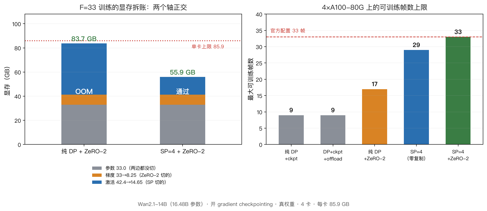

# 把 33 帧视频扩散塞进 4 张 80G 卡：一次序列并行的工程实录

> **一句话**：官方配置（33 帧）在纯数据并行下差 13 GB 训不了。
> 用 Ulysses 序列并行 + 零复制分段 + 梯度分片跑通，峰值 **55.9 GB**，同配置快 **2.46×**。
> 但真正值得写的是过程里 **4 个"不报错"的 bug**，和一套能把它们揪出来的检查法。



---

## 0. 定位（先说清，免得误会）

**这篇文章不提出新的序列并行算法。** Ulysses 的 all-to-all 换头/换 token 是 2023 年的工作。

写的是：**把一个已有方法适配到 action-conditioned 视频扩散时，通用 SP 论文不会覆盖的工程障碍，以及每一项的量化代价。**

这类"适配税"决定了别人能不能复现，通常却被一句话带过。

---

## 1. 现象：33 帧放不下，而且不是"差一点"

模型是 Wan2.1-14B 视频扩散主干（DreamZero 的 action-conditioned 版本）。官方配置直接从 `config.json` 读：

```
num_frames: 33, use_gradient_checkpointing: true
16.48B 参数 → bf16 权重 33.0 GB
40 层 / 40 head / dim 5120 / 每帧 880 token
```

33 帧 × 880 = 29040 token。加上 teacher forcing 的 clean 半边和 400 个 action/state token，序列到 **58480**。

4×A100-80G，每卡可用 **85.9 GB**（81920 MiB）。实测：

| 配置 | 结果 |
|---|---|
| 纯 DP，关 ckpt | F=9/17/25/33 **全 OOM** |
| 纯 DP，开 ckpt | F=9 75.2 GB 勉强；**F=17 OOM（差约 1 GB）**；**F=33 OOM（差 13 GB）** |

**注意 F=17 只差 1 GB。** 这个"擦边失败"是关键线索：说明问题不是"模型太大"，而是**某个随序列长度增长的量没有被任何并行手段减少**。

---

## 2. 归因：这不是一个问题，是两个正交的问题

把显存拆开看，因果链就清楚了：

```
显存 = 参数 + 梯度 + 优化器状态 + 激活
        └──── 与序列长度无关（常数）────┘   └─ 随序列长度增长 ─┘
```

- **状态轴**：参数 33.0 + 梯度 33.0 = **66.0 GB 常数**。序列再长它也不变。
- **激活轴**：实测**单层每 token 约 470 KB**。40 层、58480 token ⇒ 几十 GB，且线性增长。

数据并行（DP）只复制模型、切 batch，**对两个轴都不减少**。这就是为什么 F=17 只差 1 GB、
F=33 差 13 GB —— 差的是激活，而且差额随帧数线性放大。

于是策略自然分成两步，**缺一不可**：

1. **切激活轴** → 序列并行（本文主体）
2. **切状态轴** → 梯度分片（ZeRO-2）

> 这个拆法决定了后文所有实验的设计：我们最后必须分别证明"只用 SP 到哪"、"只用 ZeRO 到哪"、
> "合用才到 33"。**否则审稿人一定会问"到底哪个在起作用"。**

---

## 3. 为什么"直接套 Ulysses"不行

Ulysses 的思路很干净：attention 的 q/k/v 沿 head 切开分给各卡，再 all-to-all 换成沿 token 切。
这样每卡只算 `1/P` 的 head，attention 的 O(S²) 被摊到 P 张卡上。

**但这个模型的序列不是一条干净的 token 流。** 有三个约束会让"直接套"得到**静默错误**的结果。

### 障碍 1：序列尾部拼着 400 个 action/state token（几何约束）

**现象**：attention 内部靠 `(s - action_register_length) // 2` 把序列切成 clean / noisy 两半。

**根因**：`s` 在每张卡上是**局部的**。all-to-all 之后每张卡的 `s` 不同，`(s - 400)//2` 就算出不同的切点。

**后果**：切点错位 ⇒ clean/noisy 混在一起 ⇒ **不报错，只算错**。

**解法**：把 action token 单独成段，**不参与 token 维的 all-to-all**；它的 attention 用"本地 head 切片 + 出口 all_gather 拼回"的方式处理。

**代价**：多一组通信；且要求 `400 % P == 0`。

### 障碍 2：block-causal mask 以整帧（880 token）为界（对齐约束）

**现象**：最直觉的做法是把序列当连续 token 流切 `N/P`。

**根因**：`N/P` 不一定是 880 的整数倍：

- F=33, P=4 → 7260 / 880 = **8.25 帧**
- F=17, P=4 → 3740 / 880 = **4.25 帧**

`clean_frames = clean_image_seq_len // frame_seqlen` 是整除，余数被丢掉 ⇒ mask 边界错位。

**后果**：我们的 v1 这么写，**输出直接是 NaN**（这条反而是"幸运"的，因为它报了错）。

**解法**：**按帧对齐切分**。每个 rank 拿到的必须是完整的帧。

**代价**：`880 % P == 0`（P=4 时 220 ✓）；且 F 不能随便取，必须能被 P 整除地分掉首帧之外的部分。

### 障碍 3：集合通信没有 autograd（语义约束，最危险）

**现象**：

```
blocks.0.self_attn.q.weight   SP 梯度 |0.0000|   DP 梯度 |0.0318|
```

梯度精确为零。

**根因**：`torch.distributed.all_to_all_single` 和 `all_gather_into_tensor` **都不支持 autograd** ——
它们产出的张量没有 `grad_fn`。q/k/v 必须经过 all-to-all ⇒ 梯度链在这里**静默断开**。

**为什么最危险**：`backward()` 全程不报错。而且 ffn、cross-attn 等参数仍有非零梯度
（因为 action 输出没走 gather，靠 action loss 那一项漏回来了）。
**只看"loss 在降、梯度非零"，会得出"能训"的结论。**

**解法**：三种通信全部包成 `autograd.Function`，反向用**对应的逆置换**：

| 前向 | 反向 | 为什么不是归约 |
|---|---|---|
| a2a(scatter=head, gather=token) | a2a(scatter=token, gather=head) | 纯重排 |
| all_gather(token 维) | 取自己那一段 | 各 rank token 互不重叠 |
| all_gather(head 维) | 取自己那片 head | 各 rank head 互不重叠 |

参数梯度跨卡求和是 backward 之后、optimizer 之前的事，**不要塞进 a2a 的反向里**。

**代价**：需要自己实现，`torch.distributed.nn` 的现成函数语义不匹配。

---

## 4. 统一解法：零复制分段

三个障碍有一个共同的根源：**序列不是同质的**。它由三段拼成 —— 首帧、body、action register，
而且首帧和 body 又各出现两次（clean / noisy）。

所以解法是把它们拆成段，让**每段内部都是连续区间，且段长能被 P 整除**：

```
本地序列 = [首帧 220 | body 7040 | 首帧 220 | body 7040 | action 100]
            \___ clean 的 img ___/  \___ noisy 的 img ___/
                          ↑ 每卡各一段，P=4、F=33
```

**为什么这样能同时解决障碍 1 和 2**：

- 段内连续 ⇒ all-to-all 按 rank 序拼接，**恰好等于全局序** ⇒ rope 的索引、mask 的帧边界天然正确
- 段长是整帧的倍数 ⇒ `clean_frames` 整除成立
- action 单独成段 ⇒ `(s - ar_local)//2` 仍等于 clean 的本地长度；gather 之后 `clean_frames` 仍等于 F

**为什么"零复制"是必须的**（这里我们走过弯路）：

最早的版本为了简单，把首帧和 action **复制**在每张卡上。推理上更直观，但
**attention 的 q/k/v/o 按 head 切开、求和正确，MLP/o-proj 却处理全 dim 的本地 token** ⇒
复制段的贡献被算了 P 次，gradnorm 偏 **12.6%**。

这个错误在小模型测试里被掩盖了——那次 action 路径的梯度大了两个数量级，
把视频路径的偏差完全盖住。**测试不够灵敏 = 没测。**

**代价**：段长整除约束（`880 % P == 0`、`400 % P == 0`，P=4 时对任意 F 成立）。

**再进一步（v6）**：段与段之间只是**顺序问题**，不是数据问题。所以不必每段各调一次 a2a ——
可以拼成一次扁平 `all_to_all_single`，再做一次按段重排：

```
入口：send = x.view(B,T,P,nh,d).permute(2,0,3,1,4)   # 沿 head 切成 P 份
      一次 a2a → recv[p] = peer p 的本地 token（本 rank 的 head 组）
      按段重排：[P,B,nh,L,d] → [B,P*L,nh,d]（段内按 rank 序拼 = 全局序）
```

每层 collective 从 20 次降到 8 次。**但注意：这一步没有降低显存峰值**（57.0 vs 56.9 GB）——
我们原本猜它吃掉了 5.5 GB 的瞬时 buffer，实测证伪了。**猜错了就写猜错了。**

---

## 5. 剩下的那个轴：ZeRO-2，以及它替代不了 SP

### 5.1 为什么需要它

v6 之后 F=33 仍然 OOM。因为 **33.0 GB 梯度是常数**，它和激活叠在一起就超了。
把梯度切成 `1/P`：33.0 → 8.25 GB。

### 5.2 为什么"必须在 backward 里分片"（因果链）

这是整个 ZeRO 实现里唯一容易做错的地方：

```
若等 backward 结束再分片：33 GB 已经全部分配出来了 → 分片不省任何显存 ✗
若在 backward 过程中分片：每个参数的梯度一就绪就 reduce_scatter 成 1/P
                        并立刻 p.grad = None → 33 GB 从不累积 ✓
```

实现用 `register_post_accumulate_grad_hook`：

```python
def hook(param):
    g = param.grad
    out = torch.empty(g.numel() // world, dtype=g.dtype, device=g.device)
    dist.reduce_scatter_tensor(out, g.reshape(-1).contiguous(), op=SUM)
    shards[i] = out
    param.grad = None        # ← 这一行才是省显存的地方
```

更新时每卡只动自己那 1/P 片，然后用 `all_gather_into_tensor(out=p.data.view(-1), inp=分片)`
**就地**拼回全量参数——不需要额外 buffer。

### 5.3 为什么它替代不了 SP（实测，不是算术）

审稿人一定会问：「既然 ZeRO-2 降到 55.9 GB，纯 DP + ZeRO-2 是不是也能训 33 帧？」

**实测**（关掉 SP、梯度照样分片）：

| 纯 DP + ZeRO-2 | 峰值 | 结果 |
|---|---|---|
| F=9 | 52.8 GB | 通过 |
| F=17 | 68.7 GB | 通过 |
| **F=33** | **已分配 83.6 GB，再要 216 MB 时 OOM** | **失败** |

对照：SP=4 + ZeRO-2 的 F=33 = **55.9 GB**，余量 27 GB。

**因果**：ZeRO 切的是**状态轴**——参数、梯度、优化器状态，**与序列长度无关的常数**。
激活随序列增长，ZeRO 一个字节都不切。

F=33 的逐项拆账：

| 项 | DP + ZeRO-2 | SP=4 + ZeRO-2 | 谁降的 |
|---|---|---|---|
| 参数 | 33.0 | 33.0 | 都没切（切参数是 ZeRO-3/FSDP） |
| 梯度 | 8.25 | 8.25 | **ZeRO-2**（33.0/4） |
| 激活 | 42.4 | **14.65** | **SP** |
| 合计 | 83.6 → OOM | **55.9 → 通过** | |

**两个轴正交。** 单用任一个的上限：

| 只用 | 上限 |
|---|---|
| ZeRO-2（纯 DP） | **17 帧**（68.7 GB） |
| SP（v6 零复制） | **29 帧**（78.0 GB） |
| **两者合用** | **33 帧**（55.9 GB）← 官方配置 |

> 顺便说清：我们的 ZeRO-2 省下的 24.75 GB **全部是梯度**。参数一个字节都没切，
> 优化器状态按 1/P 分片（AdamW 时 16.5 GB），激活完全没动。

---

## 6. 四个"不报错"的 bug：为什么藏得住，怎么揪出来

这一节是本文最想传播的部分。四次都满足同一个模式：**不抛异常、不打警告，只把数算错**。

| # | 现象 | 为什么藏得住 | 怎么揪出来的 |
|---|---|---|---|
| ① a2a 没有 autograd | q/k/v 梯度精确为 0 | loss 正常降；action 输出没走 gather，其他参数仍有梯度 | **逐参数**对 DP 比梯度（只看总 gradnorm 会漏） |
| ② 复制段被算 P 次 | gradnorm 偏 12.6% | 那次测试里 action 路径梯度大两个数量级，掩盖了视频路径 | 按"对 gradnorm² 的贡献"排序，看谁的比值是 4.00 |
| ③ head 拼错维度 | 前向正常，反向炸 | 下游 `flatten(2)` 之后**总维度碰巧还是 512** | 反向的 shape 断言：`(2, 4)` —— 2 个 head？ |
| ④ ZeRO-2 忘回写分片 | loss 1.069 → 38.7 → 2.3e16 → NaN | 参数被"梯度的分片"覆写，纯粹数值爆炸，无异常 | 第一次 step 就发散 ⇒ 怀疑更新公式本身 |

### 还踩过两个"假信号"，值得单独记

**假阳性**：我们曾报"端到端 SP 逐元素 0 误差"。
真相是 `CausalWanModel.head` **零初始化**，随机权重下输出恒为 0，两边都是全零张量。
⇒ **等价性检查必须先断言参考值 `absmax > 0`。**

**假 OOM**：不设 `PYTORCH_CUDA_ALLOC_CONF=expandable_segments:True` 时，72–82 GB 就 OOM。
这是显存碎片，不是放不下。⇒ **14B 以上的实验一律带上这个环境变量。**

**假 FAIL**：bf16 等价性不能用 `relL2` 当判据——它随元素数按 `√N` 放大。
73.7 万个元素、每个差 1e-6，`relL2` 就到 1e-3 量级。⇒ **用 `max_abs / |ref|_max`。**

### 现在固定下来的四条检查（每次改代码都跑）

1. 参考值必须非零（`absmax > 0`）
2. 前向：`max_abs / |ref|_max < 1e-2`
3. 梯度：**逐参数**比，不只比总 norm；找出"比值恰好等于 P"的参数
4. 改完补丁要**从 pristine 重建再跑一遍**（见下）

> 第 4 条是血的教训：我们有两处 hotfix 是直接改模型文件修的，没回写补丁脚本。
> 结果一键重建把 bug 装了回来（`dim=3` 和 `_sp_segs[1:4]`）。
> **重建流程本身就是一次回归测试。**

---

## 7. 结果

| 方案 | 最大可训练帧数 | 峰值 | 单步 |
|---|---|---|---|
| 纯 DP + ckpt | 9 | 75.2 GB | 11.94s |
| DP + ckpt + activation offload | 9（**实测无效**） | 75.6 GB | 18.08s |
| 纯 DP + ZeRO-2 | 17 | 68.7 GB | — |
| SP=4（零复制） | 29 | 78.0 GB | 16.90s |
| **SP=4 + ZeRO-2** | **33** | **55.9 GB** | **20.4s** |

同配置（F=9）吞吐：DP 663 tok/s vs SP=4 **1633 tok/s** ⇒ **2.46×，4 卡并行效率 61.5%**。

为什么不是 4×：attention 只占 60.6%，剩下的 cross-attn KV、text/state 编码、
每步梯度同步、优化器更新都不随 token 切分；再加 all-to-all 占 attention 时间的 28%。

正确性（五层检查全过）：

| 检查 | 结果 |
|---|---|
| 前向（小模型，带 action） | video / action **0.0 / 0.0**（位级） |
| 前向（真权重 14B） | video 2.7e-3 / action **0.0** / loss 4.2e-6 |
| 梯度（小模型） | gradnorm **2.1e-06**，异常参数 0 个 |
| 梯度（真权重 14B） | gradnorm **2.7e-03**，逐参数 0.4–1.2% |
| ZeRO-2 vs all_reduce | loss **位级相同**，max_abs 2e-7~3e-6 |

（真权重来自官方 step-100000 checkpoint：**1317 个张量逐一对上，shape mismatch = 0**。）

---

## 8. 诚实的边界

1. **只测到 P=4**。all-to-all 占比随 P 上升（attention ∝ S/P，通信 ∝ S·(P−1)/P），2.46× 不能外推。
2. **55.9 GB 是 SP + ZeRO-2 合计**，不能单独归给 SP。SP 单独是 78 GB / 29 帧。
3. **优化器**：fp32 Adam 的状态 132 GB（分片后仍 33 GB）⇒ 总 88.9 GB 放不下。
   改用 **bf16 状态的 AdamW + 1/P 分片**，实测 **72.4 GB / 6 步降 6.0% / 无 NaN**。
   Adafactor（标量二阶矩 + 相对步长 + 更新裁剪）内存最优（55.9 GB）但 lr=1e-4 下几乎不动，
   需要大 ~100× 的 lr。**注意 bf16 状态的精度损失未做长训练评估。**
4. **没做端到端质量评估**（FVD / 任务成功率），只有 loss 与数值等价性。
5. **50 步曲线已经补到 F=33**（真权重 + SP=4 + ZeRO-2 + bf16 状态 AdamW，lr=1e-4）：
   1.0693 → 0.5861（−45.2%），峰值 72.3 GB，21.0–21.4 s/step，无 NaN，step 20 后收敛。
   但 **batch 是固定的一个**，所以它证明的是「官方配置下能稳定优化」，不是「在数据上收敛」。
6. `action=None`（纯视频）分支在 F=17 出 NaN，**DP 单卡同样 NaN**，属上游问题，未修。
7. **DP + offload 是负面结果**：换出 423 个 saved tensor，峰值 75.2 → 75.6 GB，
   一点没省还慢 1.5×。因为开 ckpt 后 saved 的只有 40 个 block 输入（≈6.6 GB），
   峰值由块内 recompute 瞬时 + 33 GB 梯度决定。这个方向打不到点上。

---

## 9. 一页因果链

```
33 帧训不了
  └─ 差 13 GB
      └─ 差的是激活（每 token 每层 ~470 KB，随序列线性增长）
          └─ 数据并行不减少激活，也不减少状态
              ├─ 切激活 → 序列并行
              │    ├─ 直接套 Ulysses 会遇到三个约束
              │    │    ├─ 尾部 400 个 action token → 单独成段（不参与 token 维 a2a）
              │    │    ├─ mask 以整帧为界     → 按帧对齐切分（880 % P == 0）
              │    │    └─ 集合通信无 autograd → 包 autograd.Function（反向=逆置换）
              │    ├─ 三者统一 → 零复制分段（段内连续 ⇒ 全局序天然正确）
              │    │    └─ 复制段会让梯度被算 P 次 → 必须零复制
              │    └─ 收益：激活 42.4 → 14.65 GB，可训练帧数 9 → 29
              └─ 切状态 → 梯度分片（ZeRO-2，必须发生在 backward 过程中）
                   └─ 收益：梯度 33.0 → 8.25 GB，帧数 29 → 33
                       （单用它只能到 17 帧 —— 因为它不碰激活）
```

**最终：9 帧 → 33 帧（3.7×），峰值 55.9 GB（比 DP 低 19 GB），同配置 2.46×，梯度相对误差 0.27%。**

---

### 复现

```bash
export PYTORCH_CUDA_ALLOC_CONF=expandable_segments:True   # 不设会有假 OOM
./apply_all.sh                                            # 从 pristine 重建四层补丁
python -m torch.distributed.run --nproc_per_node=4 test_sp_grad_small.py --frames 17 --action 1
python -m torch.distributed.run --nproc_per_node=4 train_real.py --frames 33 --steps 4 --lr 4e-3 --zero2 1 --order 4
```

细节见 `README.md`（文件地图、参数、所有对照实验的命令）。
